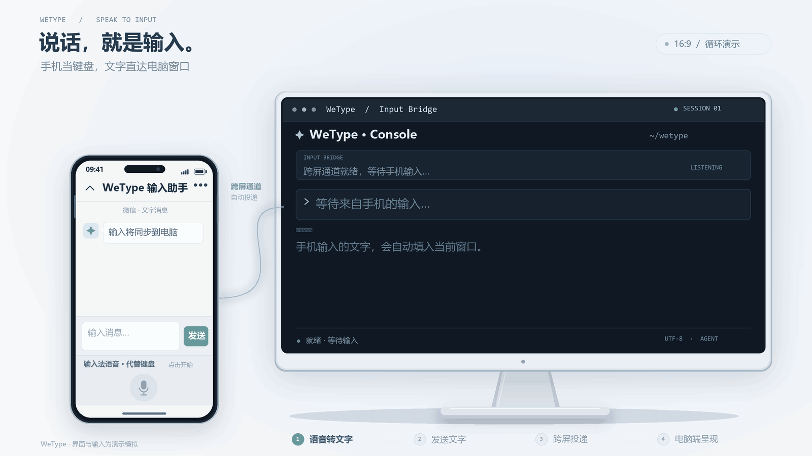

# WeType

把微信、飞书、企业微信的消息键入 Windows / macOS：快捷键锁定任意窗口，终端后台直写，不抢焦点、不占剪贴板。

在手机上给机器人发一条文字，WeType 就把它键入到电脑当前的光标处，或者键入到用 Alt+. 锁定的窗口、终端。
三个来源都是扫码即用，不需要公网 IP，凭证和本人身份自动保存，`config.json` 可以不写。
微信来源基于官方 iLink Bot API（ClawBot，小龙虾），可替代 OpenClaw 的微信渠道插件。

> 支持 Windows 和 macOS。Windows 依赖 Win32 API（`user32.dll` / `kernel32.dll`），功能完整；macOS 通过 `osascript` 驱动 System Events 键入，**不支持锁定窗口**（见下文「macOS」）。
> Linux / 云端环境只能编译与静态检查，无法验证真实键盘输入。



## 特性

- **三个来源**：微信（私聊）、飞书（机器人单聊）、企业微信（智能机器人单聊），另有调试用的控制台输入
- **扫码即用**：凭证扫码获得并自动保存，重启免扫码；飞书扫码时自动识别国内版或国际版 Lark
- **只接受本人**：微信、飞书自动记下扫码人，企业微信发一次配对码；之后只键入本人发来的消息
- **不需要公网 IP**：微信走长轮询，飞书、企业微信走长连接，都是程序主动连出
- **不键入启动前的积压消息**：程序没运行时发给机器人的消息，启动后会被确认但不键入，日志里提示忽略了多少条，避免一启动就往窗口里灌一堆旧消息
- **去重与重试**：已处理的消息 ID 记录在本地，重放或重推时不会重复键入；微信键入失败时保留游标重放，飞书回 500 期望重推
- **锁定窗口或终端**：Alt+. 锁定目标，Alt+/ 解除；终端（PowerShell、Windows Terminal、JetBrains / VS Code 终端）在后台直接写入，不切换窗口
- **Unicode 键入**：中文、Emoji 直接输入，不用剪贴板和输入法
- **断线重连**：指数退避 + 抖动；凭证失效时自动重新扫码
- **无第三方依赖**：飞书、企业微信的 WebSocket 和协议编解码都是手写的，不依赖官方 SDK

## 快速开始

1. 准备 `wetype.exe`（`config.json` 可省略，不放时使用默认配置）
2. 运行程序，默认来源是微信：

   ```bat
   wetype.exe
   ```

   用飞书或企业微信时加 `-source`，或把 `config.json` 的 `source` 改成对应的值：

   ```bat
   wetype.exe -source feishu
   wetype.exe -source wecom
   ```

   同时启用多个来源时，用英文逗号分隔（逗号两边的空格会被忽略），例如 `wetype.exe -source wechat,feishu`。启动时先按书写顺序逐个检查：凭证存在且能连上的来源立即开始监听；没有凭证、凭证文件缺字段（如 token、secret、扫码人）或服务端明确拒绝凭证的先记下。检查完后，再按同样的顺序逐个弹出扫码，前一个连通后才弹出下一个。每个来源最多等 5 分钟，超时没扫，或在本窗口输入 s 回车，就跳过它去弹下一个（包括最后一个）；被跳过的来源本次不启动，下次启动会再检查。只启用一个来源时同样适用：没有授权会弹扫码，5 分钟内没扫就跳过。全部扫码结束后如果没有任何来源可用，会打印一行日志，5 秒后自动退出。中途退出也没关系，下次启动重新按此流程检查。网络暂时不通导致无法判断时，不会当作失效，该来源直接启动并自动重连。

3. 首次运行会打印扫码链接并自动打开浏览器，用手机扫码确认（企业微信还要按提示给机器人发一次配对码）
4. 把目标窗口切到前台并点中输入框，或按 Alt+. 锁定目标窗口、终端
5. 在手机上给机器人发送文字，程序会自动键入并回车

程序常驻运行，登录成功后无需再次扫码。凭证失效或想换账号时：

```bat
wetype.exe -relogin
```

`-relogin` 对所有启用的来源生效（企业微信的配对也会重新做），但不是一次全清：按配置顺序逐个来源处理，每个来源先弹扫码，**扫成功才覆盖旧凭证**，再轮到下一个。中途退出时，还没轮到的来源凭证原样保留；某个来源没扫成功（输入 `s` 回车、等满 5 分钟跳过或扫码失败）时，只要旧凭证仍然有效就沿用，来源照常启动。启动时程序也会打印一行提示。

配置文件默认是 `wetype.exe` 所在目录下的 `config.json`，不是启动时的当前目录，所以从哪个目录启动都读同一份配置和凭证。`-config` 给相对路径时同样拼在 exe 所在目录下，给绝对路径则原样使用（凭证文件也会放在该文件所在目录）：

```bat
wetype.exe -config D:\wetype\config.json
wetype.exe -config conf\my.json
```

## macOS

- 消息始终键入到当前光标位置并回车，没有 Alt+. / Alt+/ 锁定，也没有 `-lock` / `-unlock`。先把目标窗口切到前台、点中输入框，再发消息。
- 键入用 `osascript` 驱动 System Events 的 `keystroke`，不读写剪贴板。首次使用时系统会要求授权：在“系统设置 → 隐私与安全性 → 辅助功能”里允许运行本程序的终端（或程序），并允许它控制“System Events”。没有授权时日志会提示，且不会重试。
- 输入法处于中文等输入状态时，`keystroke` 的字符可能先进入输入法的组字，建议键入时切到英文输入法；这一点没有在真机上验证。
- 打开二维码链接用系统的 `open` 命令。
- 配置文件、凭证文件的位置规则与 Windows 相同：默认在可执行文件所在目录。

## 编译
需要 Go 1.22+，无第三方依赖。

在 Windows 上直接编译：

```bat
go build -trimpath -ldflags "-s -w" -o wetype.exe ./cmd/wetype
```

在 macOS 上直接编译：

```bash
go build -trimpath -ldflags "-s -w" -o wetype ./cmd/wetype
```

在 Linux / macOS 上交叉编译 Windows 版本：

```bash
GOOS=windows GOARCH=amd64 go build -trimpath -ldflags "-s -w" -o wetype.exe ./cmd/wetype
```

静态检查（云端可用）：

```bash
go build ./...
go vet ./...
GOOS=windows GOARCH=amd64 go build -o /tmp/wetype.exe ./cmd/wetype
GOOS=windows GOARCH=amd64 go vet ./...
GOOS=darwin GOARCH=arm64 go build -o /tmp/wetype ./cmd/wetype
GOOS=darwin GOARCH=arm64 go vet ./...
```

## 配置说明

`config.json` 只放各来源共用的配置，可以不存在，此时全部使用默认值。不认识的字段会报错，避免拼错的字段被静默忽略。

不需要配置、全部自动处理的内容：

- **服务地址和协议参数**：微信的 iLink 地址、bot 类型、`channel_version`、签名、长轮询超时，企业微信的长连接地址，都内置在程序里
- **凭证**：扫码获得，存进配置文件所在目录的 `wechat_token.json` / `feishu_token.json` / `wecom_token.json`
- **本人身份**：微信、飞书取扫码人，企业微信发一次配对码；之后只接受本人的消息
- **飞书站点**：先连国内版飞书，扫码账号属于国际版 Lark 时自动切换，并记进 `feishu_token.json`

| 字段 | 默认值 | 说明 |
| --- | --- | --- |
| `source` | `"wechat"` | `wechat`（微信）、`feishu`（飞书）、`wecom`（企业微信）或 `console`（调试用），不区分大小写。可用英文逗号分隔同时启用多个，如 `"wechat, feishu"`，按顺序逐个扫码；包含 `console` 时只启用 `console`，其余来源不启动。命令行 `-source` 可临时覆盖 |
| `login.auto_open_qr` | `true` | 扫码登录时自动用浏览器打开二维码链接 |
| `reconnect.min_delay_ms` | `1000` | 断线重连的初始退避时间 |
| `reconnect.max_delay_ms` | `60000` | 最大退避时间，每次失败翻倍 |
| `inject.type_delay_ms` | `60` | 文字键入完成后、发送回车前的等待 |
| `inject.enter_delay_ms` | `120` | 回车前的额外等待 |
| `inject.press_enter` | `true` | 键入后是否发送回车 |
| `inject.max_retries` | `5` | 单条消息键入失败的重试次数 |
| `ack.reply_text` | `""` | 非空时，键入成功后向发送者回一条文本作为回执 |
| `ack.max_acked_ids` | `500` | 保留的已处理消息 ID 数量，用于去重。记录文件超过两倍时压缩 |

## 消息来源

用 `config.json` 的 `source` 选择，也可以用命令行 `-source` 临时覆盖，多个来源用英文逗号分隔。多个来源同时运行时，消息按到达顺序串行键入。`-relogin` 的处理方式见「快速开始」。三个来源都只处理文字消息：
图片、语音、文件等只在控制台打印“忽略…消息：暂只支持文字消息”，不输入、不回复。

已处理的消息 ID 逐行追加到 `wechat_acked.ids` / `feishu_acked.ids` / `wecom_acked.ids`（与凭证文件同目录），
用于在重放或重推时去重。行数超过 `ack.max_acked_ids` 的两倍时整份重写，只留最近的；进程中断导致最后一行没写完时，
读取时丢弃该行。删除这些文件只会失去去重记录，不影响登录。

### 微信（`wechat`，默认）

用手机微信扫码登录 ClawBot，然后在微信里给 ClawBot 发文字。

- 收消息走 iLink 长轮询（`getupdates` 挂起约 35 秒）
- 键入成功才推进并保存游标，失败时保留游标重放，按消息 ID 去重
- 创建时间早于本次启动的消息（离线期间积压的）只确认、不键入，日志打印
- 只接受扫码人本人的消息；凭证里没有扫码人时接受所有人（与官方插件一致）
- 会话过期（`-14`）时自动清除凭证并重新扫码
- iLink 只支持私聊；ClawBot 名额通常只有一个，重复扫码可能顶掉之前的绑定

协议细节见 [docs/wechat.md](docs/wechat.md)。

### 飞书（`feishu`）

首次运行会打印一个飞书授权链接，并在 `login.auto_open_qr` 开启时自动用浏览器打开。
用飞书 App 扫描该链接的二维码并确认，飞书会自动创建一个机器人应用，App ID、App Secret 和扫码人的 `open_id`
保存到 `feishu_token.json`。然后在飞书里给这个机器人发单聊消息即可。

- 收消息走飞书长连接（WebSocket）
- 只处理机器人单聊；群聊消息只在控制台提示
- 只接受扫码人本人的消息
- 键入失败时向飞书返回 500、不记为已处理，期望飞书重推；键入成功或按规则忽略时返回 200
- 企业组织账号扫码创建的应用需要管理员审核后才能使用；审核前在飞书里找不到这个机器人

扫码用的应用注册接口取自飞书官方安装工具 `@larksuite/openclaw-lark-tools`，开放平台没有公开文档，接口变化时扫码可能失效。
协议细节见 [docs/feishu.md](docs/feishu.md)。

### 企业微信（`wecom`）

首次运行会打印企业微信的扫码页面地址，并在 `login.auto_open_qr` 开启时自动用浏览器打开。用企业微信扫描页面上的二维码，
会创建一个智能机器人并接入本程序，Bot ID 和 Secret 保存到 `wecom_token.json`。

扫码结果里没有扫码人的身份，所以还要配对：控制台会显示一个 6 位配对码，在企业微信里把它发给机器人，
程序就把你的 `userid` 记为本人，并回复“配对成功”。配对前不键入任何消息，配对后只接受本人的消息。
换机器人或 `-relogin` 后需要重新配对。

- 收消息走企业微信长连接（`wss://openws.work.weixin.qq.com`）
- 只处理机器人单聊；群聊消息只在控制台提示
- 企业微信不会因为键入失败而重推，键入失败的消息只记日志
- 同一个机器人只能有一个长连接。在别处又连上时，本程序会收到通知并退出，避免两边互相挤下线

扫码接口取自企业微信官方命令行工具 `wecom-cli`，长连接协议取自官方 SDK `@wecom/aibot-node-sdk`，都没有公开文档。
协议细节见 [docs/wecom.md](docs/wecom.md)。

### 控制台（`console`，调试用）

```bat
wetype.exe -source console
```

不连接任何服务，每在本程序窗口输入一行并回车，就当作收到一条消息。先切到目标终端按 Alt+. 锁定，再回到本窗口输入即可。
未锁定时，回车后有 3 秒时间切到目标窗口。

## 锁定窗口或终端（Alt+. / Alt+/）

快捷键：

| 操作 | 效果 |
|---|---|
| 未锁定时按 Alt+. | 锁定当前窗口或终端 |
| 已锁定，在**别的**窗口或终端标签里按 Alt+. | 锁定切换到当前这个 |
| 已锁定，在**锁定的那个**里按 Alt+. | 解除锁定 |
| 在任意位置按 Alt+/ | 直接解除锁定 |

左右两个 Alt 键都可以。按下到提示卡片出现，实测 30～260 毫秒。

锁定后的发送方式：

- **终端**（PowerShell、cmd、Windows Terminal、IntelliJ IDEA / GoLand 等 JetBrains 终端、VS Code 终端）：
  在后台直接写入该终端，**不切换窗口、不闪烁、不打断你正在别处打字**。
  - Windows Terminal 有多个标签时，按窗口标题确认当前标签。
  - JetBrains / VS Code 的终端：按下 Alt+. 后，程序把窗口右边和底边临时内移再恢复（窗口右边和底部会轻微闪一下）。先内移 24 像素，没有反应再逐级加到 64、120 像素，
    终端停靠在 IDE 主窗口里时也能识别。终端单独成窗口时约 0.1 秒。
    IDE 只会调整正在显示的终端的尺寸，由此确定锁定哪个标签。Reworked 2025 和 Classic 引擎、Window / Float / 停靠等显示模式都适用。
    通知里会显示锁定标签的提示符，方便确认。
  - 也可以在目标终端里运行 `wetype.exe -lock` 精确锁定它；`-unlock` 解除。
- **其他窗口**（浏览器、IDE 的代码编辑器、终端被隐藏的 IDE 窗口等）：发送时短暂切到该窗口输入，再切回原来的窗口。
  凡是探测不到正在显示的终端，都按这种方式处理。
- 锁定的窗口或终端关闭后，消息不再发送（该消息被丢弃），并弹出提示。
- 每次状态变化都会在屏幕右下角弹出彩色提示卡片：新卡片把旧的往上顶，越旧越透明，几秒后淡出消失；不抢焦点，也不挡鼠标。
- 如果 Alt+. 已被其他程序占用，启动时会打印警告，锁定功能不可用；只有 Alt+/ 被占用时，可在已锁定的目标里按 Alt+. 解除。

原理、支持的窗口类别和已知限制详见 [docs/window-lock.md](docs/window-lock.md)。

## 键入原理

1. 文本按 UTF-16 码元拆分为 `KEYEVENTF_UNICODE` 键事件（每个码元一次按下 + 一次抬起）
2. 换行、制表符转换为 `VK_RETURN`、`VK_TAB` 虚拟键
3. 每 512 个事件一批调用 `SendInput`，中文、Emoji 无需剪贴板或输入法
4. 可选等待后发送回车按下/抬起

键击作用于**当前前台窗口**，因此未锁定时需把目标窗口置前并点中输入框。锁定终端时改为后台写入控制台输入缓冲区，
见 [docs/window-lock.md](docs/window-lock.md)。

## 常见问题

| 现象 | 排查方向 |
| --- | --- |
| 一直停在等待扫码 | 检查网络能否访问对应来源的地址：微信 `ilinkai.weixin.qq.com`；飞书 `accounts.feishu.cn`、`open.feishu.cn`（Lark 为 `accounts.larksuite.com`、`open.larksuite.com`）；企业微信 `work.weixin.qq.com`、`openws.work.weixin.qq.com`。公司网络可能屏蔽了其中的域名。二维码过期会自动刷新 |
| 收到消息但没有键入，日志也没报错 | 目标程序很可能以管理员身份运行：Windows 会静默丢弃普通权限程序发给管理员窗口的模拟按键（UIPI）。在任务管理器“详细信息”页加上“已提升”列查看；让本程序也以管理员身份运行，或让目标程序以普通权限运行 |
| 收到消息但输入到了别的窗口 | 未锁定时键入跟随当前前台焦点；按 Alt+. 锁定目标窗口或终端，见上文和 [docs/window-lock.md](docs/window-lock.md) |
| 日志显示“忽略非本人的消息” | 只接受扫码人（企业微信为配对人）的消息。换了账号时用 `-relogin` 重新扫码 |
| 企业微信一直不键入 | 还没配对：按控制台提示把 6 位配对码发给机器人 |
| 飞书在企业账号下找不到机器人 | 应用还在等管理员审核 |
| 中文变成乱码或丢失 | 目标控件需支持 `WM_CHAR` / Unicode 输入；部分游戏、远程桌面或安全控件会拦截合成键击 |
| 偶尔重复输入 | 来源没有提供消息 ID 时无法去重，属于预期情况 |
| 频繁出现重新扫码 | 平台侧主动失效或重复绑定顶号，重新扫码即可 |

日志直接输出到控制台，每行以时间开头，然后是前缀 `[wetype]`；各来源自己的日志带渠道名，如 `[wetype-wechat]`、`[wetype-feishu]`、`[wetype-wecom]`、`[wetype-console]`，同时运行多个来源时可据此区分。可以用日志判断登录、收消息、ACK 与重连状态。

## 安全与限制

- `*_token.json` 含各来源的凭证（微信 bot_token、飞书 App Secret、企业微信 Secret），等同于机器人的收发权限，请勿提交到仓库或外传；程序以 `0600` 写入，已在 `.gitignore` 中忽略
- 目标窗口以管理员身份运行时，本程序必须也以管理员身份运行，否则按键会被系统静默丢弃；锁定管理员终端时同样无法后台写入
- UAC 安全桌面、部分游戏和安全控件会拒绝合成键击
- 仅支持 Windows 和 macOS；macOS 不支持锁定窗口、后台写终端，键入依赖辅助功能权限

## 项目结构

```
wetype/
├── cmd/
│   └── wetype/
│       └── main.go              程序入口：参数、选择消息来源、装配投递与锁定
├── internal/
│   ├── config/                  配置：共用配置的结构、默认值、校验
│   ├── source/                  消息来源
│   │   ├── source.go            来源接口 Source、消息 Message、Handler、ErrDiscarded，以及同时运行多个来源的 Multi
│   │   ├── wechat/              微信（iLink Bot API）：签名、扫码、长轮询、ACK、重连、回执
│   │   ├── feishu/              飞书：扫码创建机器人、长连接、pbbp2 帧编解码、事件处理、回执
│   │   ├── wecom/               企业微信：扫码创建智能机器人、长连接、配对、回执
│   │   └── console/             控制台（调试用）
│   ├── delivery/                投递
│   │   ├── delivery.go          投递器 Deliverer、Injector、CursorInjector
│   │   ├── winlock/             快捷键锁定：状态与语义、目标识别、热键、提示卡片
│   │   └── wintype/             键入：SendInput、切前台输入、后台写终端、进程快照；macOS 用 osascript（applescript.go、input_darwin.go）；*_other.go 为其他平台占位
│   ├── browser/                 辅助：用系统默认浏览器打开扫码链接（Windows 用 rundll32，macOS 用 open）
│   ├── store/                   辅助：凭证（*_token.json）和已处理消息 ID（*_acked.ids）的持久化
│   └── ws/                      辅助：最小 WebSocket 客户端（RFC 6455），飞书和企业微信共用
│       └── wstest/              测试用的 WebSocket 服务端
├── docs/
│   ├── window-lock.md           锁定功能的原理与支持范围
│   ├── wechat.md                微信来源的协议细节
│   ├── feishu.md                飞书来源的协议细节与调研记录
│   ├── wecom.md                 企业微信来源的协议细节与调研记录
│   └── image/                   README 演示动画（wetype-demo.gif）
├── config.json                  运行配置（可省略）
├── *_token.json                 运行后生成：各来源的凭证与本人身份
├── *_acked.ids                  运行后生成：已处理消息 ID，一行一个
├── go.mod
└── README.md
```

分层约定：

- `cmd` 只负责进程生命周期与依赖装配
- `internal/source/*` 只是消息来源，只依赖 `internal/source`、`internal/config`、`internal/store`、`internal/ws`、`internal/browser`，不调用键盘输入
- `internal/delivery` 负责投递，Win32 调用只在 `delivery/wintype` 和 `delivery/winlock` 的 `*_windows.go` 里，其他包不依赖 `syscall` / `unsafe`
- 凭证和消息记录的读写全部通过 `internal/store`
- `internal/config`、`internal/store`、`internal/ws`、`internal/browser` 没有内部依赖（`ws/wstest` 只依赖 `ws`），可被任意层引用

## 许可证

本项目基于 [Apache License 2.0](LICENSE) 开源，Copyright 2026 TimAndy。
